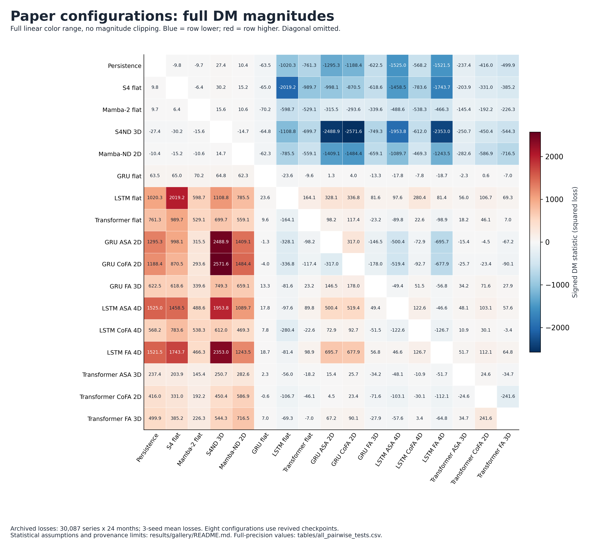
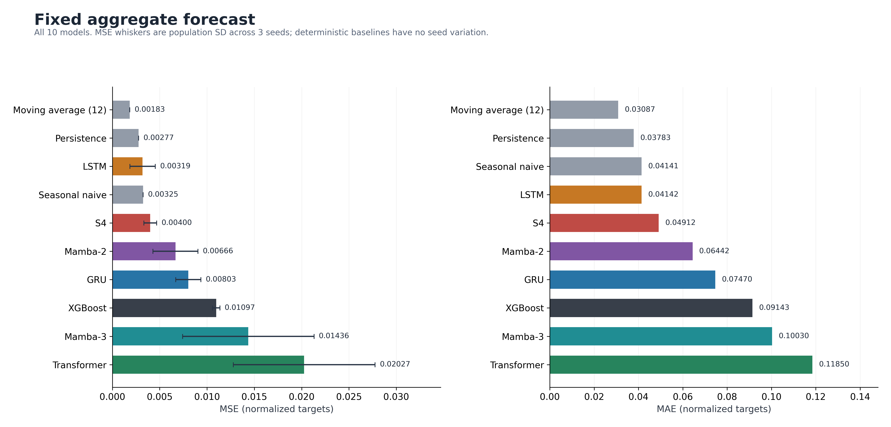
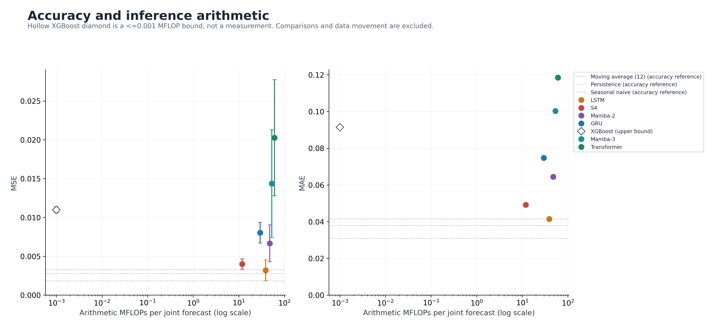
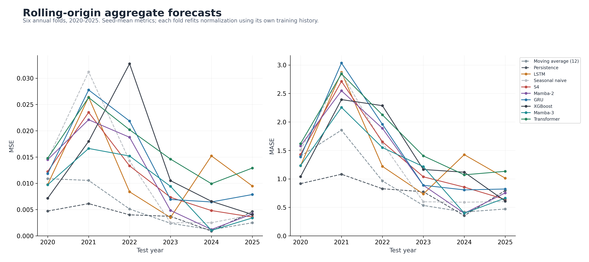
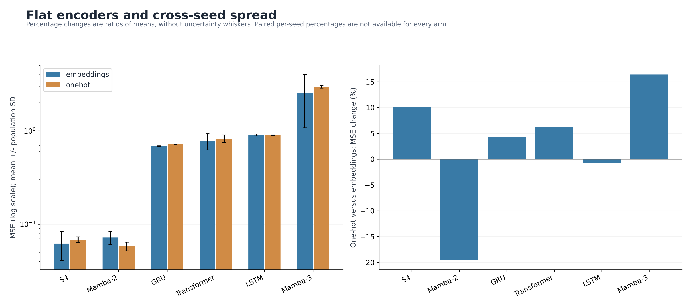
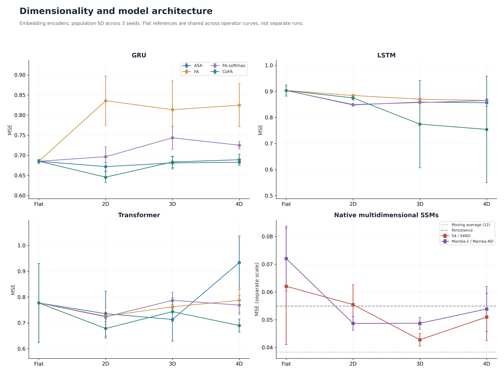
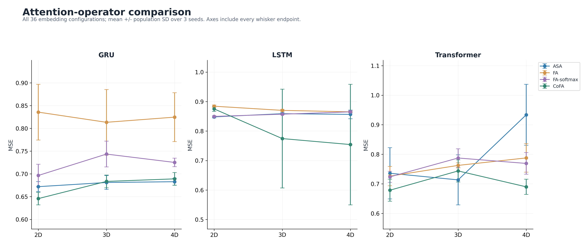
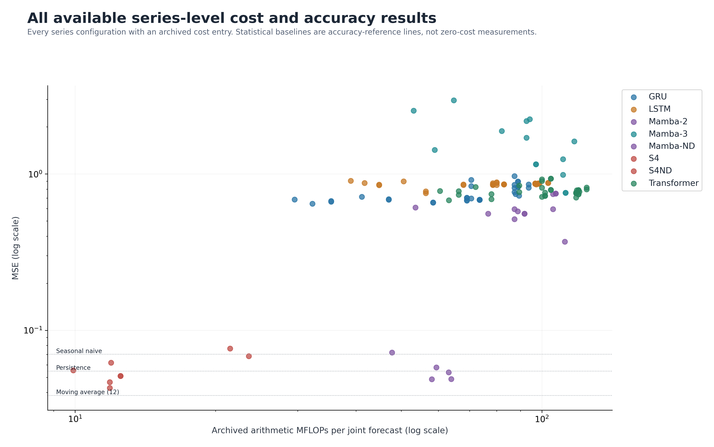

# Full results and figure gallery

Supplementary re-analysis and rendering, 23 September 2026. This directory
preserves the original reported values and makes additional comparisons
inspectable. It is not a replacement manuscript, a publisher correction, a
new training run, or a fresh inference/profile measurement.

## Downloads and previews

- [Complete Excel workbook](hpec_results.xlsx): nine sheets, including all
  results, costs, per-seed metrics, pairwise tests, training diagnostics and
  learning-rate judgments.
- [Searchable HTML gallery](index.html): download the repository and open this
  file locally. GitHub displays its source rather than hosting the page.
- [All 218 result rows](tables/all_results.csv), retaining stored precision.
- [All 225 archived cost rows](tables/all_costs.csv), including configurations
  without a matching archived accuracy row.
- [All 1,035 pairwise comparisons](tables/all_pairwise_tests.csv).
- [The paper's 136-comparison subset](tables/paper_pairwise_tests.csv).
- [46 loss-arm means and provenance](tables/loss_arms.csv) and
  [135 per-seed loss summaries](tables/loss_per_seed.csv).
- [Original XGBoost per-seed/channel results](tables/xgboost_per_seed.csv).
- [Numerical verification summary](tables/verification.json).

Each figure is supplied as a **300-dpi PNG and scalable SVG/PDF**. Large
heatmaps exceed 5,000 pixels in width. Vector files can be enlarged without
raster resolution loss. The complete figure inventory, including descriptions,
is in [figure_catalog.json](figure_catalog.json).

### Full-magnitude heatmaps

These display **all 46 configurations supported by the recovered loss archive**,
not every configuration in the accuracy table. Unavailable paired losses are
not invented. Models are ordered by mean MSE in the full heatmaps; the smaller
paper views retain the paper's order.

| View | PNG | SVG | PDF |
|---|---|---|---|
| Full signed DM statistics | [PNG](figures/heatmap_all_dm.png) | [SVG](figures/heatmap_all_dm.svg) | [PDF](figures/heatmap_all_dm.pdf) |
| Full signed Wilcoxon z | [PNG](figures/heatmap_all_wilcoxon.png) | [SVG](figures/heatmap_all_wilcoxon.svg) | [PDF](figures/heatmap_all_wilcoxon.pdf) |
| Absolute MSE differences | [PNG](figures/heatmap_all_mse_difference.png) | [SVG](figures/heatmap_all_mse_difference.svg) | [PDF](figures/heatmap_all_mse_difference.pdf) |
| Relative MSE differences | [PNG](figures/heatmap_all_mse_relative.png) | [SVG](figures/heatmap_all_mse_relative.svg) | [PDF](figures/heatmap_all_mse_relative.pdf) |
| HAC + Holm difference decisions | [PNG](figures/heatmap_all_hac_holm.png) | [SVG](figures/heatmap_all_hac_holm.svg) | [PDF](figures/heatmap_all_hac_holm.pdf) |
| Separate MSE equivalence decisions | [PNG](figures/heatmap_all_equivalence.png) | [SVG](figures/heatmap_all_equivalence.svg) | [PDF](figures/heatmap_all_equivalence.pdf) |
| Paper roster: full DM magnitudes | [PNG](figures/heatmap_paper_dm.png) | [SVG](figures/heatmap_paper_dm.svg) | [PDF](figures/heatmap_paper_dm.pdf) |
| Paper roster: full Wilcoxon magnitudes | [PNG](figures/heatmap_paper_wilcoxon.png) | [SVG](figures/heatmap_paper_wilcoxon.svg) | [PDF](figures/heatmap_paper_wilcoxon.pdf) |
| Paper roster: HAC + Holm decisions | [PNG](figures/heatmap_paper_hac_holm.png) | [SVG](figures/heatmap_paper_hac_holm.svg) | [PDF](figures/heatmap_paper_hac_holm.pdf) |



Colors use the **full symmetric linear range** of each statistic/difference,
with no saturation threshold or magnitude clipping. Near-zero cells may look
pale when extreme magnitudes dominate the range. Cell text is rounded for
legibility; CSVs retain computed precision. Negative values mean the row has
lower loss than the column. A large statistic is not a large practical effect:
the MSE-difference maps show effect size separately. Relative changes use the
column as the denominator and are therefore not antisymmetric.

### Accuracy and cost comparisons















All 138 available series-level rows are also shown in four descriptive ranking
pages: [1](figures/series_ranking_01.png), [2](figures/series_ranking_02.png),
[3](figures/series_ranking_03.png), [4](figures/series_ranking_04.png).
The [learning-rate map](figures/learning_rate_diagnostics.png) preserves the
38-configuration diagnostic roster and its original category wording.

## Interpretation and corrections to earlier plotting conventions

1. **Missing costs are not zero.** The original aggregate plotting code mapped
   unavailable costs to zero. Here recorded FLOPs, analytical FLOPs, and
   analytical upper bounds occupy separate columns. The XGBoost diamond is a
   labeled upper bound. Baselines are horizontal accuracy references on cost
   plots, not measurements at the origin.
2. **Whiskers show the complete range.** MSE uncertainty is the population
   standard deviation across three training seeds (`ddof=0`), not a confidence
   interval or a significance test. No LSTM CoFA or Transformer ASA endpoint
   is deliberately clipped. Deterministic baseline variation is zero.
3. **Encoder percentage changes have no error bars.** These are ratios of
   reported means. The previously propagated error bars must not be read as
   empirical SDs of paired-seed percentage changes; those pairs are not
   available for every displayed encoder arm.
4. **Endpoints are separate.** DM maps use squared loss; Wilcoxon uses
   per-series MAE. Equivalence is shown on its own MSE-based map, not overlaid
   on Wilcoxon as though it tested MAE equivalence.
5. **Selection and diagnostics are descriptive.** The 17-model paper roster
   is called "paper configurations," not "best-performing configurations."
   Learning-rate labels are diagnostic hypotheses, not established causal
   explanations or proof of an optimal rate.

### XGBoost arithmetic bound

The archived configuration fits two square-error regressors, one for value and
one for weight, with at most 500 depth-4 trees each. Initializing prediction
with the base score and adding one leaf score per active tree requires at most
**1,000 floating-point additions per joint forecast (0.001 MFLOPs)**. Learning
rate scaling is incorporated in fitted leaf values. Separately, abstract
root-to-leaf traversal requires at most **4,000 threshold comparisons**.

This is an **analytical model-arithmetic upper bound**, not the historical
measured cost or a bound on every backend instruction. It excludes training,
feature preparation, inverse normalization, data movement, missing-value
checks and implementation overhead. FLOPs are not watts or latency. The
three seeds are independent repetitions, not a three-model inference ensemble.
Early stopping usually reduces active trees. The original metrics file did
not retain boosters or best-iteration counts. A local reconstruction did not
exactly reproduce the archived metrics, so its tree counts are not used here.

For statistical baselines, pure persistence/seasonal copying requires zero
arithmetic FLOPs, while directly averaging 12 values requires 11 additions
and one division per output, or 24 arithmetic FLOPs for the two outputs.
This does not imply zero runtime for copying, nor include feature/preprocessing
cost. These counts are labeled analytical and do not replace absent profiler
measurements. Neural costs retain the existing warmed-forward profiling plus
analytic-top-up convention in `scripts/model_cost.py`; FLOPs alone do not
equate the execution costs of tree and dense neural algorithms.

## Statistical methods and limits

- The archive has 30,087 series by 24 test months. Trained-arm loss arrays are
  averaged across seeds 947, 732 and 619 before pairwise tests; this is average
  **loss**, not loss from ensembled predictions.
- Original DM: monthly cross-sectional mean squared-loss differentials,
  lag-0 variance, one-step HLN correction and a Student t reference with 23
  degrees of freedom. All **1,035 DM and signed Wilcoxon statistics** reproduce
  the archived table to its printed precision. The computed magnitudes and
  p-values are saved without arbitrary rounding in the CSV.
- Sensitivity: Bartlett/Newey-West covariance with lags 1, 3 and 6, the same
  one-step finite-sample scaling and t reference, followed by Holm correction
  over the declared pair family. The full family has 1,035 comparisons; the
  separately adjusted paper family has 136. Do not interchange these columns.
  Lag 3 is a displayed sensitivity choice, not a uniquely mandated correction.
- Full-family original DM detects 1,013 of 1,035 differences at 0.05;
  HAC lag 3 + Holm detects 965. For the paper family the corresponding counts
  are 134 and 130 of 136. These are conditional decisions, not a certification
  that dependence or training-seed uncertainty has been fully resolved.
- Wilcoxon is a signed-rank normal approximation on per-series mean MAE
  differences, dropping zero differences, with average ranks and tie correction,
  without continuity correction. Cross-series independence is a limitation
  for related trade series. Holm addresses multiplicity, not this dependence.
  `wilcoxon_log10_p` retains tail magnitude when floating-point p-values
  underflow to zero; zero must not be read as a literal probability of zero.
- MSE TOST uses a margin of 5% of the **reference column's MSE**, the original
  lag-0 standard error and alpha 0.05, without multiplicity correction.
  Direction-specific margins produce an asymmetric map. A failure to detect
  a difference is not evidence of equivalence. No new HAC-adjusted equivalence
  claim is made.
- Smaller mean error or a higher ranking is not evidence of consistent
  superiority across training seeds. Only three seeds are available.

## Table conventions and provenance

Original CSVs under `results/` and `artifacts/exp7/`, `artifacts/exp8/` remain
unchanged. The master table merges matching identifiers and rejects
conflicting duplicate metrics. It adds the three fixed-aggregate baselines
from recovered figure inputs and XGBoost summaries from its original seed
records. It contains 10 fixed-aggregate rows, 60 annual rolling rows, 10 pooled
rolling rows and 138 series-level rows. Dataset scopes are never pooled together.

For XGBoost rolling summaries, metrics are averaged over equal-length annual
folds within seed, then across seeds. Within-seed pooled RMSE is the square
root of pooled MSE, following `evaluate._pooled_rolling_rows`; the final RMSE
is the mean of those seedwise RMSEs. Pooled SD is the spread of the three
within-seed pooled MSE values, not the spread across years. Archived sMAPE,
MASE and normalization conventions are retained, not redefined here.

The recovered full loss archive merges 111 runs declared fingerprint-validated
with **24 revived runs (eight configurations)** whose tree fingerprints were
not revalidated; those were checked against logged MSE to five decimal places.
[loss_arms.csv](tables/loss_arms.csv) identifies them individually.
The metadata records checkpoint hashes and this qualification in
[loss_provenance.json](inputs/loss_provenance.json). This supplement does not
upgrade those runs to freshly verified checkpoint inference.

The 680-MB source loss archive is not duplicated in Git. Its hash and origin
are recorded, and a roughly 10-MB compressed collection of sufficient loss
summaries is included to reproduce these comparisons: per-pair monthly
differentials, per-series mean losses and arm means. In particular, the
original float32 subtraction/reduction is retained for exact DM replay rather
than replaced with subtraction of separately rounded arm means.

[MANIFEST.json](MANIFEST.json) pins input hashes and calculation versions;
[inputs/SOURCES.json](inputs/SOURCES.json) identifies recovered source files.
These are archival-source claims, not a new end-to-end data/checkpoint audit.

## Rebuild

The main gallery uses NumPy, SciPy and Matplotlib, no GPU or training:

```bash
python scripts/results_gallery.py
python -m pytest tests/test_results_gallery.py
```

`--dpi 600` creates denser PNGs; SVG/PDF are already resolution-independent.
`--tables-only` recomputes CSVs without rerendering figures.
The optional Excel authoring script, `node scripts/gallery_workbook.mjs`,
requires `@oai/artifact-tool` and reads the generated workbook-data intermediate.
All raw and computed values are available as CSV without that optional package.

To re-extract compact summaries from the original recovered archive:

```bash
python scripts/prepare_results_gallery.py --archive-dir /path/to/archive
```

The archive directory must contain `xgboost_all.json` and `FINAL_BATCH/`.
Extraction records fresh hashes; it does not train models or validate original
checkpoint execution. Changes to source data should be reviewed, not silently
accepted as a new version of the original results.
